# WeFO – Weather · Forecast · Observer

[](LICENSE)

WeFO (*Weather · Forecast · Observer*) is a small self-hosted web app that puts the forecasts of many **free** weather models side by side, hour by hour, and adds a final row with a **probability derived from how much the models agree** (optionally weighted by how reliable each model has recently been for your location).

- Backend: **PHP 8** + **SQLite** (no framework, no Composer)
- Frontend: plain **HTML / CSS / JavaScript** (no build step), [Leaflet](https://leafletjs.com/) for the map
- UI languages: **English** (default) and **Greek** – switch with the `EN | ΕΛ` buttons in the header
- **Light / dark theme** – follows your system setting; use the sun/moon button next to the language switch to override it
- No API keys needed for the forecast, Sky Conditions or DSO Explorer (only the optional **Trip** route search needs a free OpenRouteService key). The whole app sits behind a [login](#users-and-login) with users and an administrator
- Beyond the forecast: a [Sky Conditions](#sky-conditions-open-to-everyone) tab (Sun, Moon, seeing, transparency, light pollution), a [Sunset & sunrise](#sunset--sunrise-colours-forecast-tab) outlook and a [DSO Explorer](#dso-explorer-open-to-everyone) with tonight's best deep-sky targets

> The probabilities are a measure of model agreement. They are **not** an official forecast and must not be used for safety-critical decisions.

---

## Screenshots

**Forecast – weather** (hero card with the rain outlook and EMY warnings, the *Days ahead* card with high / low, the chance of rain – a blend of the ensemble and the model vote, see [Methodology](#methodology) – and the peak gust; below, the Weather tab's five-lane dashboard – Weather, Agree, Temp, Rain, Wind – with the individual models collapsed behind *Show all models*; the current interval is highlighted)

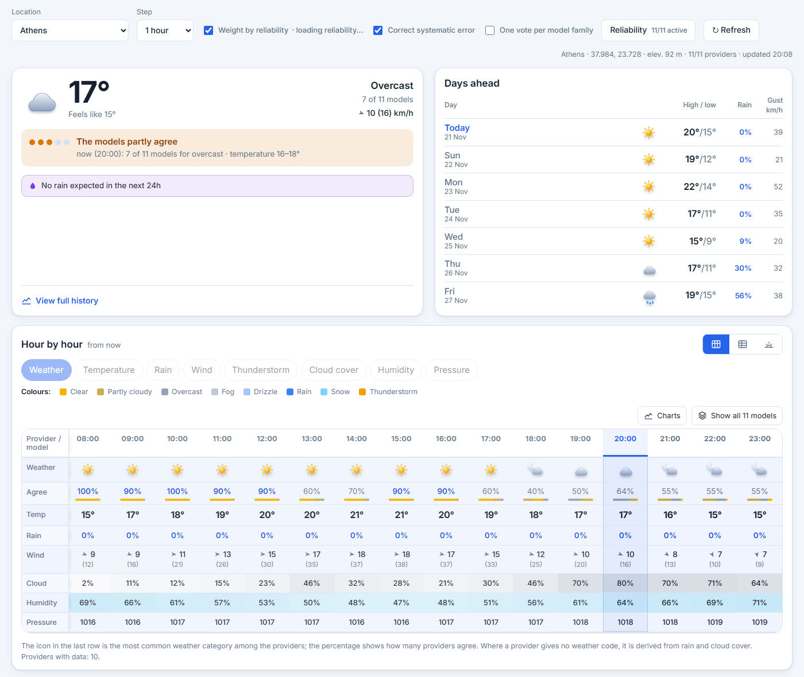

**Hourly charts** – the *Charts* button under the table opens temperature, precipitation, wind and cloud cover for the selected day: the line is the (weighted) average, the shaded band is the range of the models, the dashed band the P10–P90 of the ensemble

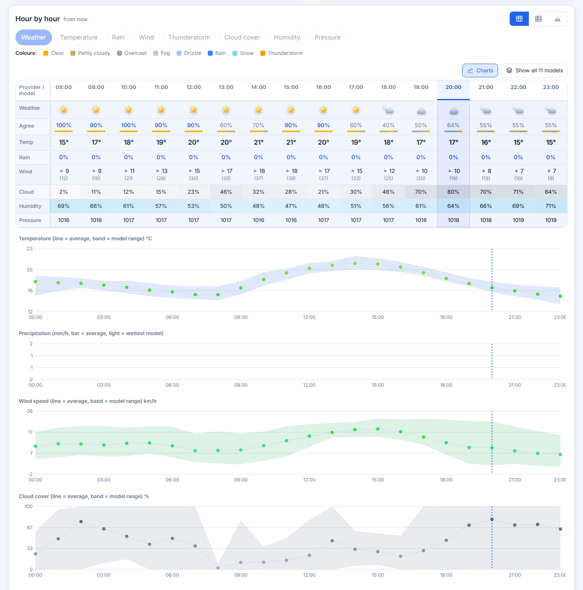

**Time down** – the same table transposed to one row per hour (consensus only; follows the day you pick)

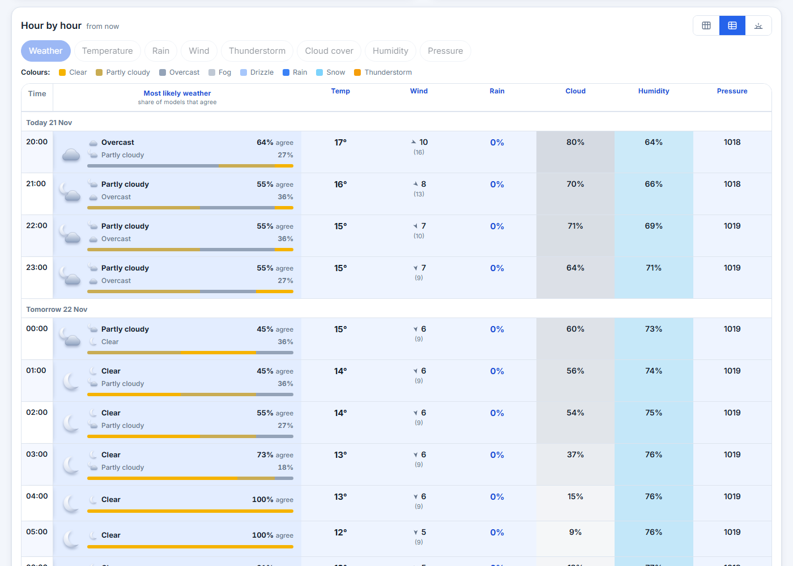

**Sunset & sunrise colours** – the last icon of the *Hour by hour* switch: a 0–100 outlook for the next seven sunsets (or sunrises) from the cloud layers along the Sun's direction, with golden/blue hour windows

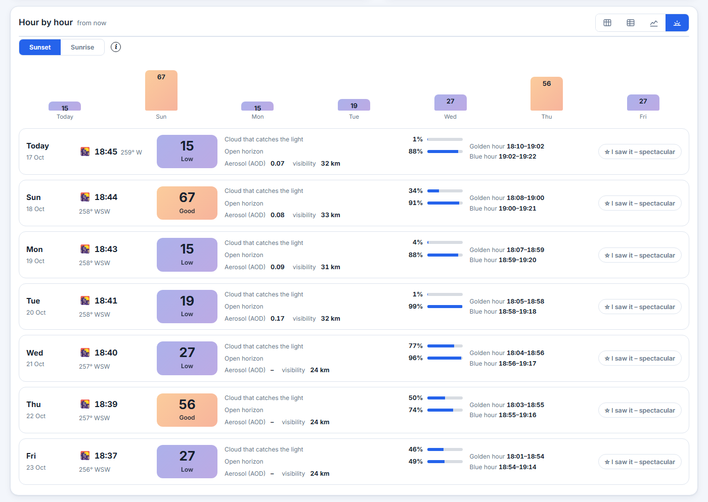

**Rain** – per-model rainfall per step, average and chance of rain

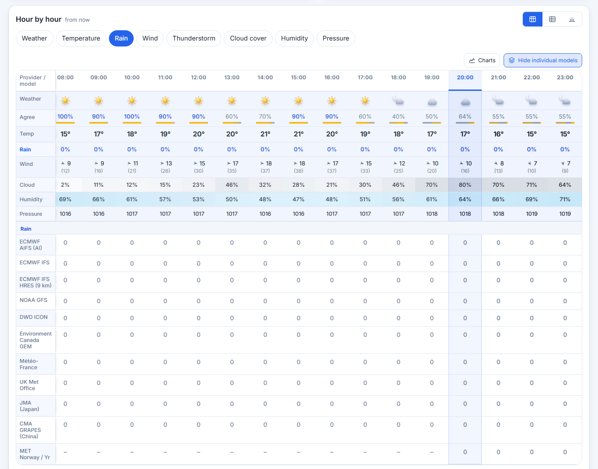

**Wind** – speed, direction arrow and gusts per model, chance of strong wind

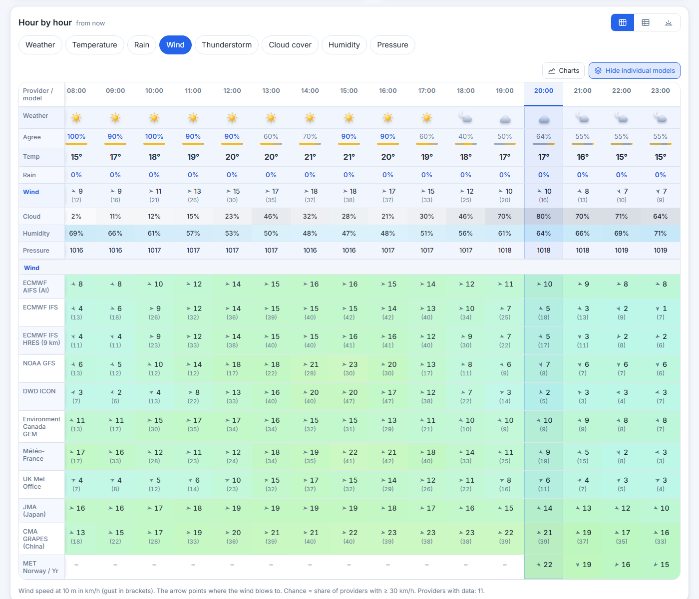

**Sky Conditions** – light pollution map on top, one card per night (Moon, astronomical darkness, best three hours), then the hour-by-hour table with Sun/Moon altitude charts, twilight bands, seeing, transparency and the deep-sky score

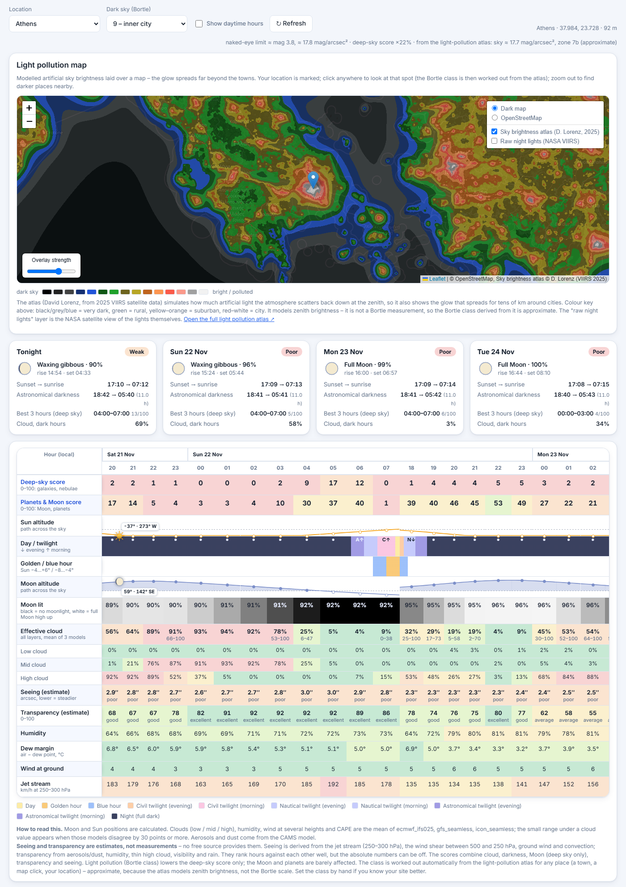

**Light pollution map** – David Lorenz's sky-brightness atlas laid over a dark map (with the NASA VIIRS night lights as a second overlay); click anywhere to look at that spot, the Bortle class is worked out from the atlas

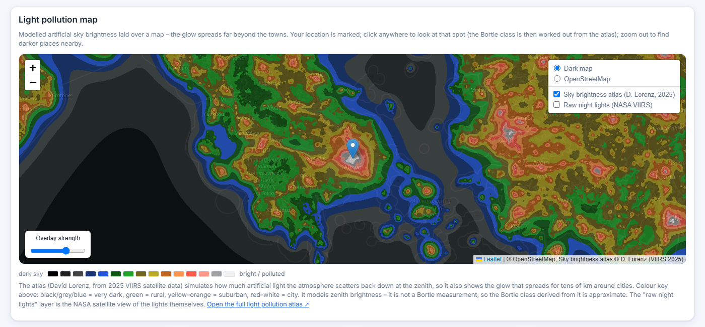

**DSO Explorer** – tonight's night summary and day phases, then the best deep-sky targets: photo, facts, Moon / cloud / deep-sky hour boxes and a 24 h altitude chart, one object per line

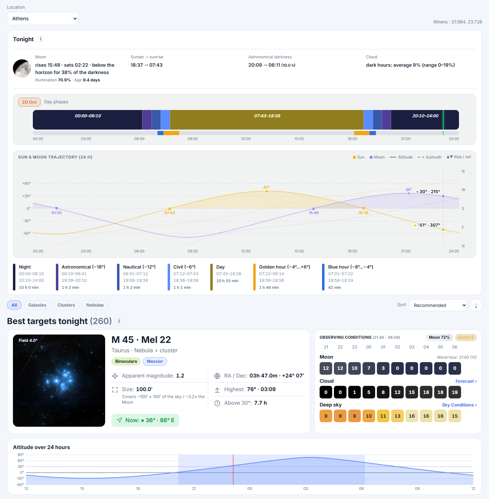

**Locations & Map** – pick a point on the map, search, save locations (with an optional elevation)

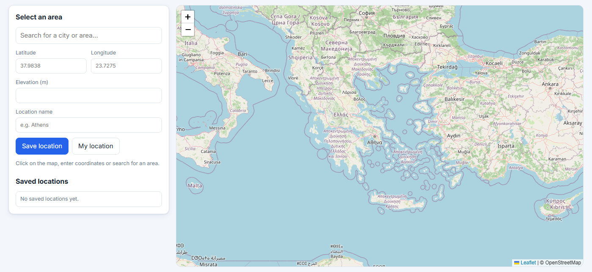

**Location history** – shown below the map when you click *History*: records, annual/monthly climate and charts since 1940 (downloaded once, then only new days are added)

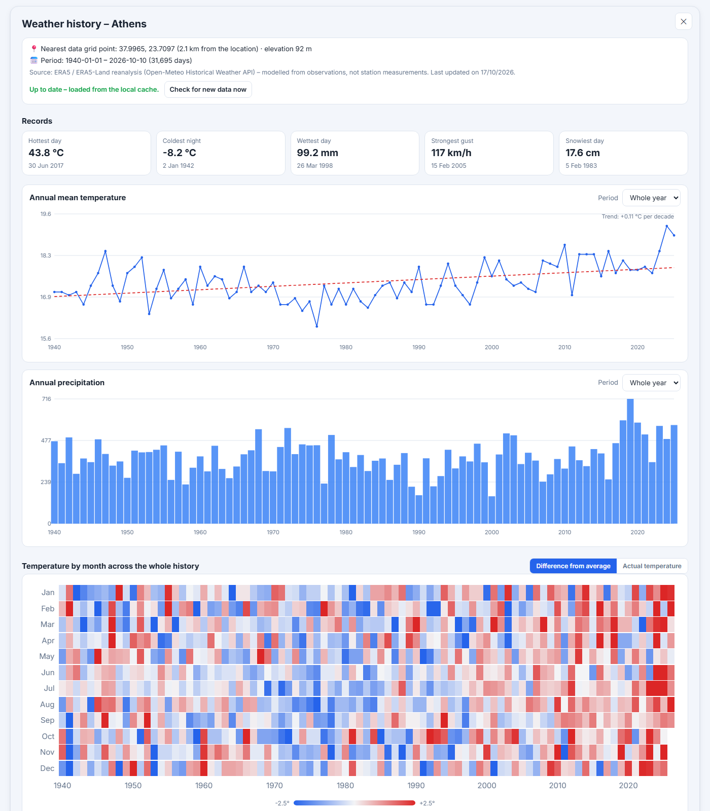

**Dark theme**

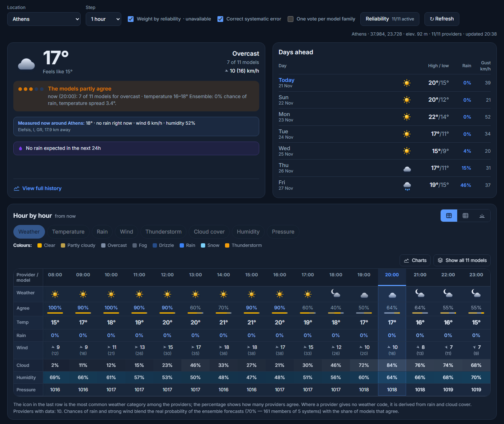

**Responsive layout** (phone) and **Greek UI**

<p>
  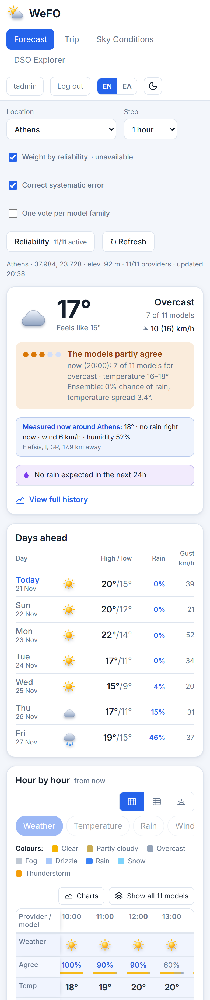
  &nbsp;
  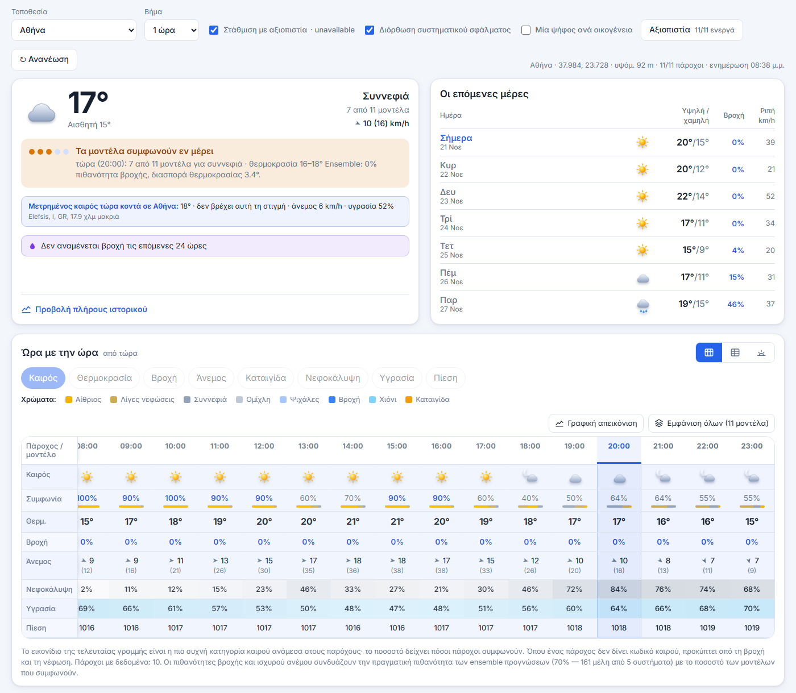
</p>

---

_The screenshots are regenerated with `node tools/screenshots.js` (headless Edge/Chrome against a local copy; pass a user name and password for the login)._

---

## Table of contents

1. [Screenshots](#screenshots)
2. [What it shows](#what-it-shows)
3. [How it works](#how-it-works)
4. [Methodology](#methodology)
5. [Requirements](#requirements)
6. [Installation](#installation)
7. [Users and login](#users-and-login)
8. [Configuration](#configuration)
9. [Project structure](#project-structure)
10. [HTTP API](#http-api)
11. [Data, privacy and external services](#data-privacy-and-external-services)
12. [Limitations](#limitations)
13. [Adding a language](#adding-a-language)
14. [Troubleshooting](#troubleshooting)

---

## What it shows

### Locations & Map

Every logged-in user can open *Locations & Map* and save their own locations (private to them); they appear in the *Location* drop-down next to the Greek cities, and the **Choose on map…** entry and **My location** work without saving anything.

- Pick a place by **clicking on the map**, typing **latitude/longitude**, **searching by name**, or using **My location**.
- The name is filled in automatically (reverse geocoding) and you can edit it.
- **Save** the location: it is stored in the SQLite database and appears in the *Location* drop-down of the Forecast page. Saved locations are shown on the map and can be deleted.
- **History** button next to every saved location: opens the long-term weather history for that place (see below).

### Location history

Click **History** next to a saved location and a section opens **below the map** (nothing is shown until you choose a location) with what the weather has been like there since **1940**:

- **Coverage:** which data grid point was used (its coordinates, its distance from your location and its elevation), the period and the number of days available.
- **Records:** hottest day, coldest night, wettest day, strongest gust, snowiest day, with dates.
- **Charts (full width):** *Annual mean temperature* (with a trend line in °C per decade) and *Annual precipitation*. Each chart has its own **Period** drop-down: *Whole year* shows the annual value, while choosing a month (e.g. *January*) shows the mean temperature – or the total rainfall – of that month for every year in the history.
- **Temperature heatmap:** one cell for every month of every year since 1940 (columns = years, rows = months). By default the colour is the **difference from that month's long-term average** (red warmer, blue colder), so you can see at once how every month has changed over the whole history; a switch shows the actual temperature instead.
- **Monthly climate:** average temperature (mean / max / min), rainfall and rainy days for each month over all years.
- **Year by year:** mean / max / min temperature, precipitation (with bars), rainy days (≥ 1 mm), strongest gust and snowfall.

The first time you open it, the app downloads the complete daily series (about 1.5 MB, a few seconds) from the Open-Meteo Historical Weather API for the grid point **nearest to the coordinates** (ERA5 / ERA5-Land reanalysis, ~10 km resolution) and **stores it in SQLite**. Every later visit is served from the local database in a fraction of a second, and **only the days that are not stored yet are downloaded and appended** (checked at most once every 6 hours, or immediately with *Check for new data now*). Deleting a location also deletes its stored history. Note that this is a reanalysis (a model constrained by observations), not station measurements.

### Forecast

Choose a saved location and you get a two-column layout: a **hero card** and the **days-ahead** list on the left, the hour-by-hour table on the right (stacked on narrow screens).

1. **Hero card**: current conditions right now (icon, temperature, feels-like, wind) and a **verdict** strip — a 1–5 dot scale plus a sentence saying how much the models agree (*"The models mostly/partly agree" / "are split"*), with the temperature range behind it. Below it, three lines built from three different sources, from most to least "real-time": a **"Measured now"** line with real METAR observations (temperature, wind, humidity, rain) from the nearest airport station (`api/observed.php`, via aviationweather.gov — the same source `api/verify.php` uses for reliability scoring), a **radar "Next break"** line sampled from RainViewer's live radar composite at the exact point (`api/radar.php`, needs the `gd` PHP extension — degrades silently without it), and finally the model-based one-line **rain outlook** (*"Rain expected from 13:00"*, *"Next break: dry from …"*, *"No rain expected in the next Nh"*), computed by scanning the next 24 hours for the next change in the rain-probability consensus. Each line only appears when its data source actually has something for that location. A **View full history** link jumps straight to that location's [long-term history](#location-history).
2. **Days ahead** (7 days): one row per day with icon, high/low, chance of rain (≥ 1 mm) and peak gust; click a day to jump the table below to it.
3. **Parameter tabs**, each showing one table (the Weather tab also shows a colour legend for the category icons above the table). By default each table is **consensus-first**: on the **Weather** tab it shows a five-row dashboard — **Weather** (top category icon), **Agree** (its share), **Temp**, **Rain** (chance + mm) and **Wind** (speed, gusts, direction) — all at once; every other tab shows its own average/agreement pair (see the table below). A **"Show all N models"** button reveals every individual provider's row underneath (plus, on the Weather tab, the named AI models, which stay visible either way). A **Time across / Time down / Sunset** switch changes how the table is shown: *across* keeps time as columns with one row per provider (as below); *down* turns it into a one-row-per-hour agenda for the selected day (average + probability only, better for narrow screens or scanning many hours at once; clicking another day in *Days ahead* moves it there); *Sunset* opens the [sunset & sunrise outlook](#sunset--sunrise-colours-forecast-tab). The **Charts** button above the table (time-across layout) draws temperature, precipitation, wind and cloud cover for the selected day under the table: a line for the weighted average, a band for the range of the models and a dashed P10–P90 band from the ensemble. Everything reflects the same **Weight by reliability** setting.

   | Tab | Provider cells | Second-to-last row | **Last row (probability)** |
   |---|---|---|---|
   | **Weather** | weather icon + temperature | *(see the five-lane dashboard above instead)* | every weather category predicted by the models with its share (e.g. *Clear 55 %, Overcast 27 %, Partly cloudy 18 %*) is what the **Weather** lane's icon summarises; the **Agree** lane is its share |
   | **Temperature** | °C, colour-coded | average, min–max | agreement % and ± standard deviation |
   | **Rain** | mm per step | average, max | chance of rain (share of models above the step's threshold: 0.2 / 0.5 / 1 mm for 1 / 3 / 6–12 h) |
   | **Wind** | 10 m speed km/h, arrow = direction the wind blows towards, gust in brackets | average and range, mean direction | chance of strong wind (share of models ≥ 30 km/h) and of gusts ≥ 60 km/h |
   | **Thunderstorm** | CAPE (J/kg) and a bolt when the model forecasts a thunderstorm | average CAPE | chance of thunderstorm |
   | **Cloud cover / Humidity / Pressure** | value, colour-coded | average, min–max | agreement % |

   The **Reliability** button above the table opens the [Reliability window](#model-verification-reliability-window) (scores, per-day scores, and the switches for individual models).

4. **Step**: 1, 3, 6 or 12 hours. Values are aggregated per step (rain = sum, gust/CAPE = max, weather code = most severe, wind direction = speed-weighted circular mean, others = mean).
5. The **current time interval is highlighted** (whole column) and, when the table needs horizontal scrolling, it is **automatically centred**. Past intervals are slightly dimmed.
6. **Reliability** button: the model scores, and the switches that turn individual models on and off (see below).
7. Three checkboxes: **Weight by reliability** (on/off), **Correct systematic error** and **One vote per model family** – see [Methodology](#methodology). Your choices are kept in the browser and, once you are logged in, on the server (`user_prefs`) so they follow you to another device.
8. **Refresh** forces a fresh download (otherwise data is cached for 30 minutes).

### Sky Conditions (open to everyone)

A separate tab next to *Forecast* with the observing conditions for the selected location, hour by hour:

- **Computed in the browser** (`js/astro.js`): Sun altitude and the twilight stages (down to astronomical darkness), Moon altitude, lit fraction, phase, moonrise/moonset.
- **From the weather models** (`api/astro.php`, mean of ECMWF IFS, NOAA GFS and DWD ICON via Open-Meteo): low/mid/high cloud, humidity, dew point, wind at the ground and at 850/700/500/300/250 hPa (jet stream), CAPE, visibility; plus aerosols and dust from CAMS (Open-Meteo air-quality API).
- **Estimated** (no free source measures them): *seeing* (from the jet stream, upper-air wind shear, ground wind and convection) and *transparency* (from aerosols/dust, humidity, thin high cloud, visibility, rain). They rank hours against each other well, but the absolute values are approximate, and the tab says so.
- Two 0–100 scores per hour — *deep sky* (cloud, darkness, Moon, transparency, seeing) and *planets & Moon* — and one card per night with sunset/sunrise, astronomical darkness, Moon, and the best three hours.
- A **light pollution map** below the table: David Lorenz's sky-brightness atlas (VIIRS 2025, a simulation of the artificial glow that also spreads far around cities) laid over a dark map, plus the raw NASA VIIRS night lights as a second overlay, an opacity slider, and click-to-look-there. Both come straight from the browser to `djlorenz.github.io` and NASA GIBS (free, no key); a link opens the full lightpollutionmap.info atlas.
- **Light pollution (Bortle class 1–9)** is worked out automatically for any place: the browser reads the colour of the atlas tile under the point (zone → zenith sky brightness → approximate class; the atlas models zenith brightness and is not a Bortle measurement). It scales the deep-sky score (class 8 keeps about a third of it) and shows the naked-eye limiting magnitude. The *Dark sky* drop-down overrides it: a visitor's choice is remembered in their browser; an admin's choice is stored in the database with the location (`bortle_set`) and beats the atlas for everybody. The Greek towns also carry a rough size-based guess, used only if the atlas can't be reached.

### Sunset & sunrise colours (Forecast tab)

The last icon of the *Hour by hour* switch (a half sun over the horizon) opens a seven-day outlook for **sunset** and **sunrise**: a 0–100 score per day (Weak / Low / Fair / Good / Spectacular), the time and direction of the Sun, the golden and blue hour windows, and the factors behind the score. It is an estimate: high and mid cloud catch the light (best at about 45 % cover), the horizon on the Sun's side has to be open (low cloud at 80–150 km along its azimuth hides it — `api/skypoints.php` forecasts points along that direction), a little aerosol deepens the reds, and rain or poor visibility spoil it. For the events of the next 30 hours the low and mid cloud is also pulled towards **real airport data** along the Sun's direction (`api/aviation.php`: METAR observations of the last hours and TAF forecasts valid for about 9–30 h, from aviationweather.gov; the nearest station within 70 / 90 km of each horizon point; the TAF counts for 40–60 %, a METAR only for the next ~3 hours). Automatic stations only see cloud below ~12 000 ft, so they cannot see high cirrus: they tell whether the horizon will be blocked, not how much cloud there is to catch the light. The *I saw it* stars are kept only in your browser.

### Trip (Greece only, open to everyone, needs a free OpenRouteService key)

A tab next to *Forecast*: pick a start and a destination (and "now" or a departure time within the next 6 days) and it shows up to three driving routes with distance, driving time, arrival, climb, the length on toll roads and the **toll cost**, a map coloured by how bad the weather is along the way, the "what to expect" warnings, a chart of temperature / rain / elevation and a stage-by-stage table. The weather is the **multi-model consensus**: `api/tripweather.php` reads ECMWF IFS and AIFS, GFS, ICON, Météo-France, UK Met Office and GEM at points about every 20 km, each at the time you will really be there (the route's own timetable), and shows the weather most models agree on with the share that agrees. **You choose the models**: a *Models* drop-down with checkboxes in the form (one, several or all; at least one stays on; the choice is remembered in the browser). Changing it re-analyses the forecast that is already loaded, so the map colours, the warnings, the weather along the route, the chart and the *Stage by stage* list all update at once, without a new request; a model that returned nothing for the route is struck through in the list. "Slippery", fog and gust notes are estimates from the forecast, not road-authority reports. Routes come from OpenRouteService through `api/route.php` (cached for 6 hours; put a free key in `api/config.php` as `ors_api_key`, or in the `WEFO_ORS_API_KEY` environment variable). The search is limited to Greece. **Toll costs** come from our own table, `data/tolls_gr.json`: about 110 plazas of the Greek motorways (Egnatia, A1 / Aegean Motorway / Kentriki Odos, Olympia Odos, Ionia Odos, Moreas, E65 and the Rio–Antirrio bridge) with their OpenStreetMap positions and class-1 (car) prices; a route is charged for every plaza it passes within ~120 m. Attiki Odos is not in the table yet and the prices must be updated by hand when the operators change them (the file has an `asof` date). `php tools/test-route.php` checks the parsing and the toll matching offline. **Fuel / energy**: pick petrol, diesel, hybrid or electric, then a make and model from `assets/cars.json` (about 5,250 entries from the US EPA fuel-economy data, built by `python tools/build-cars.py`, combined cycle converted to L/100 km and kWh/100 km), or one of the "Typical cars", or type your own consumption and price — the numbers always stay editable. The EPA list has no European-only models; `assets/cars_eu.json` adds those, currently Škoda (80 versions) and the Hyundai i10 with the official WLTP combined figures (read from autotijd.be by `python tools/build-cars-eu.py skoda hyundai:i10`), and the Alfa Romeo 147 with the real-world consumption owners report on auto-abc.eu (`python tools/build-cars-abc.py "Alfa Romeo" 147`), and the typical cars and manual entry cover the rest.

### DSO Explorer (open to everyone)

A page for deep-sky observing, next to *Sky Conditions*. Everything is computed in the browser from three static files in `assets/` (the 2936-object catalogue, the 1627 stars to magnitude 5 and the constellation lines):

- **Tonight** (the only list; the catalogue browser was dropped): sunset/sunrise, astronomical darkness (Sun below −18°, or sunset + 90 min … sunrise − 90 min where it never gets that dark), Moon rise/set and how much of the darkness the Moon is down, the cloud forecast for the dark hours (the same three-model mean as the Sky Conditions tab), and the best targets: catalogue objects with a magnitude that reach 30° and stay above it for an hour or more, ranked by effective magnitude, with a "Moon nearby" warning. The list can be re-sorted by altitude right now, peak altitude tonight, size or apparent magnitude (brightest first), with an arrow to reverse the order.
- **Every target is one full-width line** with everything on it: a big DSS2 photo (click it for the zoomable photo and the offline finding chart, stereographic, north up), the facts (names, type, size, RA/Dec, peak altitude and time, hours above 30°, current altitude/azimuth, visibility class, catalogue flags), a 24 h altitude chart and the hourly Moon-light and cloud strips for the longest dark spell above 20°. There is no separate object page.
- **Visibility class is an estimate:** surface brightness SB = mag + 2.5·log10(π/4·a·b·3600), effective magnitude = mag + 0.5·max(0, SB − 20.5); ≤ 8.5 binoculars (the brightest of these are visible to the naked eye too), ≤ 14 telescope, otherwise very difficult. It assumes a dark sky and no Moon.
- **Weather models:** the *Weather models* drop-down in the toolbar chooses which models the cloud (and the seeing / transparency behind the deep-sky score) is averaged over: ECMWF IFS, NOAA GFS and DWD ICON by default, plus Météo-France, UK Met Office, Canada GEM, JMA and CMA GRAPES — all checked with a real Open-Meteo call to return cloud layers, humidity and winds aloft for Greece (where a model lacks visibility or CAPE the mean uses the models that have it). At least one stays on; a moment after the last tick the forecast is fetched again. The choice is kept in the browser and applies to this page only (`api/astro.php?models=a,b,c`, whitelisted; the Sky Conditions tab keeps its default three).
- **Map:** the *Map* button opens the light-pollution map in a dialog (the atlas over a dark map, NASA night lights as a second overlay, an opacity slider); click anywhere to look at that spot, and the Bortle class shows on the marker.
- **Offline:** `sw.js` (a small service worker) keeps the data files and every photo you have opened; the finding chart needs no network at all. Photos: Digitized Sky Survey (DSS2), STScI/NASA via CDS.
- `node tools/test-dso.js` checks the maths: transit altitude/azimuth of M31, M42 and M45, the visibility classes of the reference objects, the night figures and the Moon-strip values.

### Choosing the models

- In the **Reliability window** each model has a checkbox, a short note about **which regions it is best for** and its reliability score (0–100) once verification has loaded.
- Disabled models disappear from the tables and from all averages and probabilities. At least one model must stay enabled; the new choice is applied when you close the window.
- The choice is saved in your browser (`localStorage`) and, when you are logged in, also on the server (`user_prefs`, `api/prefs.php`), and applies to all locations.
- Models that cannot cover the selected location are listed under *No coverage for this location*.
- Some regional models (KNMI, DMI, MET Norway Nordic) silently return a **copy of a global model** outside their domain. WeFO detects this **hour by hour**: a model is a copy of an earlier one at hour *i* when temperature, rain, wind and pressure are identical over the window *i*−3 … *i*+3 (a one-hour coincidence is not enough). Copied hours are left out of every average, share and agreement, and are shown dimmed on the model's own row with the tooltip *Same data as X from DD/MM HH:00* — so a seamless model that is genuine for the first two days and an ECMWF copy afterwards counts for the first two days only. A model that is a copy for the whole period is greyed out with the note *Same data as …* (as before).

---

## How it works

A short tour follows; the step-by-step description of every calculation, with all the constants, is in [Methodology](#methodology).

### Data sources

| Provider | How it is fetched |
|---|---|
| **ECMWF AIFS** (AI / neural-network forecast), ECMWF IFS, NOAA GFS, DWD ICON, Environment Canada GEM, Météo-France, UK Met Office, JMA, CMA GRAPES, BOM ACCESS, KNMI, DMI, MET Norway Nordic | one request to the [Open-Meteo forecast API](https://open-meteo.com/) with the `models=` parameter |
| MET Norway / Yr (global) | directly from the [MET Norway Locationforecast API](https://api.met.no/) (converted to the same hourly format) |

Real observations used only for the reliability score come from [aviationweather.gov](https://aviationweather.gov/data/api/) (METAR). Models that return no data for the location are dropped automatically. **ECMWF AIFS** is ECMWF's newer AI/neural-network forecast system (as opposed to the physics-based numerical models everything else here uses) – it is included as just another model in the comparison, weighted like the rest by the [reliability](#model-verification-reliability-window) score. **Google WeatherNext 3** (Google DeepMind's AI model) can optionally be added the same way – see [below](#optional-google-weathernext-3-and-the-wefo-vs-ai-comparison); it needs your own API key and is off by default. Everything is fetched **server-side** (`api/forecast.php`) and cached in SQLite for **30 minutes** per location (Google WeatherNext 3 has its own, longer cache – see below).

### Consensus and probability

For every time step and every parameter WeFO collects one value per active provider and computes:

- **Average / range** – (weighted) mean, min and max of the provider values.
- **Weather category** – WMO weather codes are grouped into *clear, partly cloudy, overcast, fog, drizzle, rain, snow, thunderstorm*. Each provider votes for its category; the shares are shown as percentages. If a provider gives no weather code it is derived from precipitation, temperature (snow), CAPE and cloud cover.
- **Chance of rain** – share of providers with at least a threshold of rain in the step. The threshold grows with the step, because over a long block a mere trace adds up: **0.2 mm** for a 1 h step, **0.5 mm** for 3 h, **1 mm** for 6 h and 12 h (the *Days ahead* card, 24 h, uses the same 1 mm). Yr only publishes a 6-hourly rain total for the later hours; the API spreads it evenly over those hours and flags them (`precip_6h_block`), and the UI ignores such hours in steps shorter than 6 h.
- **Ensemble probability** – "how many models agree" is a vote, not a probability. `api/ensemble.php` therefore also asks the Open-Meteo **Ensemble API** for five ensemble systems (ECMWF IFS 51 members, NOAA GEFS 31, DWD ICON 40, Environment Canada GEM 21, UK Met Office 18) and reduces them on the server: for every step (1, 3, 6, 12, 24 h) the share of members with rain above the step's threshold, with mean wind ≥ 30 km/h and with a gust ≥ 60 km/h, plus hourly P10 / P50 / P90 of temperature and rain. Each *system* counts once, so ECMWF's 51 members do not drown the others. The **chance of rain**, **chance of strong wind**, the gust share and the *Days ahead* rain chance are then `P = 0.7 × P_ensemble + 0.3 × P_consensus` (`ENS_BETA` in `js/app.js`); if the ensemble is not available the consensus alone is used. The meteogram-style charts add a dashed P10–P90 band (rain: a whisker) next to the model range, and the hero card's verdict can only be *lowered* by the ensemble: a rain chance near 50 % or a wide temperature spread (≥ 4 °C / ≥ 8 °C, `ENS_SPREAD_MID/LOW`) means the models do not really agree. Hover the *Rain* / *Wind* lane labels for a short explanation of the difference between the two.
- **Systematic-error correction** (checkbox *Correct systematic error*, on by default, remembered in the browser) – the verification also measures how much too warm / too windy each model runs (`corr` in `api/verify.php`, per lead day). The correction is applied to every value *before* any average, share or agreement: temperature, pressure and humidity are shifted by the bias (METAR bias if there is one, ERA5 otherwise; limits ±3 °C, ±4 hPa, ±15 %), wind and gusts are multiplied by truth/model (limits 0.7–1.3). Rain and cloud are never corrected. Corrected values on a model's own row carry a thin underline and a tooltip with the amount.
- **Models checked and not added** – for Athens and Thessaloniki, `italia_meteo_arpae_icon_2i` returns no data, `gfs_graphcast025` returns only empty values, and `icon_eu`, `ukmo_global_deterministic_10km` and `meteofrance_arpege_europe` return exactly the same numbers as `icon_seamless`, `ukmo_seamless` and `meteofrance_seamless` there, so they would only be duplicates. `ecmwf_ifs` (HRES 9 km) does return its own data and was added (family `ecmwf`, not yet verified because the verification APIs were not reachable to confirm it).
- **Related models** – MET Norway / Yr is built on ECMWF outside the Nordic countries, so it is not an independent opinion. WeFO compares its temperature with ECMWF IFS over the whole forecast; if the correlation is above 0.97 *and* both change in the same direction in at least 90 % of the hours, Yr's weight is halved (constants `ECMWF_COPY_R`, `ECMWF_COPY_TREND`, `ECMWF_COPY_FACTOR` in `js/app.js`; the figures are shown under the model in the Reliability window). In practice the correlation is usually lower (about 0.8–0.9 in Greece), so the cut only applies when Yr really mirrors ECMWF. Every model has a `family` in `api/models.php` (ECMWF IFS, AIFS and Yr are the `ecmwf` family); the optional **One vote per model family** checkbox shares one vote between the active members of a family.
- **Chance of strong wind** – share of providers with ≥ **30 km/h** (Beaufort 5).
- **Chance of thunderstorm** – each provider gives a signal between 0 and 1: weather code 95–99 = 1; otherwise `clamp((CAPE − 300) / 1500)`, multiplied by 0.4 when convective inhibition is strong (CIN > 100 J/kg — Open-Meteo reports CIN as a positive number), by 1.2 when the lifted index is below −3, and by 1.3 when the block has ≥ 0.5 mm of rain or by 0.6 when it has none. The chance is the (weighted) mean signal. CAPE comes from nearly every model, the lifted index only from GFS and CMA and CIN from GFS, ICON, UKMO, CMA, KNMI, DMI and MET Nordic; a missing term simply does not modify the signal. `lightning_potential` was checked and no model returns it for Greece, so it is not used. The constants (`STORM_*`) are at the top of `js/app.js`.
- **Agreement** (temperature, cloud, humidity, pressure) – `100 % × (1 − σ / tolerance)`, where σ is the standard deviation between providers and the tolerance is 4 °C, 50 %, 25 %, 4 hPa respectively (0 % when σ ≥ tolerance).

The thresholds are constants at the top of `js/app.js` (`RAIN_THR_BY_HOURS`, `WIND_THR`, `TOL`).

### Model verification (Reliability window)

`api/verify.php` (the work itself is in `api/verify_lib.php`) compares every model's *archived forecasts* (Open-Meteo **Historical Forecast API**) with two references: the **ERA5 reanalysis** (Open-Meteo **Archive API**, last 28 days, ending 6 days ago since ERA5 is published with a delay — available everywhere, but a model product of ECMWF's own system, so it slightly favours ECMWF) and **real METAR observations** (hourly reports from [aviationweather.gov](https://aviationweather.gov/data/api/), no key needed — measured temperature, dew point → relative humidity, wind, pressure, cloud cover and present weather).

**For a location in Greece**, both references are pooled **nationwide** rather than computed per visited place: every Greek METAR-reporting airport is discovered (an ICAO `LG*` bounding-box query, not a fixed list — currently ~23 stations), and for *each station* a separate archived forecast is fetched **at that station's own coordinates** and compared with its METAR reports, plus ERA5 at that same point. All stations' comparisons are pooled into one score per model, computed once and cached for **every** Greek location (24 hours), rather than redone per place. This matters because comparing a forecast computed for the *visitor's* point against a station tens of km away would partly measure real local weather differences (coastal effects, elevation), not model skill — fetching the forecast at each station's own point instead removes that bias, and pooling many stations gives a far more stable score than any single nearest station would. Fetching dozens of stations' archived forecasts concurrently runs into Open-Meteo's burst rate limit (HTTP 429 past roughly 5 simultaneous requests), so they're fetched in small chunks with automatic retry rather than all at once — the first request after the daily cache expires takes signficantly longer (tens of seconds) than a normal cached response.

**For a location outside Greece**, the original per-location approach is used instead: the archived forecast at that point vs. ERA5 there, and, if a METAR station is within 60 km, a *separate* archived forecast fetched at the station's own coordinates (same point-matching principle, just for one station) vs. its reports.

For each model and reference it computes: mean absolute error and bias for temperature, wind, cloud cover, humidity and pressure; the *critical success index* for detecting wet hours; and the share of hours with the correct weather category (drizzle and rain are treated as one category for this comparison).

**Combining the two:** per parameter, `skill = 0.6 × METAR skill + 0.4 × ERA5 skill` when at least 48 matched hourly observations exist; otherwise ERA5 alone is used. Observations get the larger share because ERA5 is not independent of the models being judged. The **score (0–100)** is the mean skill across parameters, and the skills are turned into **weights between 0.5 and 1.8** (average = 1) per parameter. With *Weight by reliability* enabled, the averages, chances and weather-category shares use these weights, so better models count more.

**Lead times.** The Historical Forecast API stitches together the first hours of every model run, so on its own it measures how good a model is a few hours ahead — yet a forecast for day 5 is a different animal. WeFO therefore also asks the Open-Meteo **Previous Runs API** (`previous-runs-api.open-meteo.com`, variables such as `temperature_2m_previous_day3`: the forecast issued 3 days earlier) for **lead days 1, 2, 3, 5 and 7** and scores each lead separately with the same procedure. The response has `weights_by_lead` (lead day → model → weight per parameter) and `models[m].by_lead` (score per lead). Not every model offers every lead (checked for Athens: ICON, UKMO up to 6 days, Météo-France 3, CMA 4, BOM none; `weather_code` is missing for several models at leads ≥ 1); a missing lead is bridged by linear interpolation, and beyond the last one the nearest is held. A lead based on fewer than 300 matched hours is pulled towards weight 1 (`SHRINK_N`). In the browser, every column of the table takes the weights that fit its distance in hours from the moment the forecast was fetched, blending the two neighbouring lead days linearly; the Reliability window shows the score per forecast day for each model (small bars).

**Nightly job.** All this is heavy (dozens of stations × models × leads, ~1.5 MB per station), so it is done by `php tools/verify-cron.php` once a night, which fills the cache (`vf4:greece`). `api/verify.php` only serves the cache: a fresh entry is returned as it is; a *stale* one (older than 24 h) is still returned immediately, marked `"stale": true` (and refreshed in the background where PHP-FPM allows it); only when there is no cache at all (first run) does it compute on the spot, lead 0 only, like before. Crontab on the VPS:

```
15 3 * * * php /var/www/wefo/tools/verify-cron.php >> /var/log/wefo-verify.log 2>&1
```

The Reliability window states **how fresh and how solid** the numbers are: when they were computed, the method (nationwide pool / single place, the tilt towards the nearest stations, whether weights are per forecast day), the comparison window and number of matched hours, the number of hours behind each model's score, and a *stale* warning when the cache is older than 24 h.

In the Reliability window every cell shows the error against ERA5 and, in blue, the error against METAR; the note under the table explains which method was used — the list of pooled stations for Greece, or the single nearest station (name, distance, report count) elsewhere.

Notes and caveats:

- An airport is a point measurement. Distance, elevation and local effects (sea breeze, urban heat) add errors that affect all models similarly.
- Pressure comes from the METAR sea-level pressure (or altimeter setting), and rain/weather from the *present-weather* code at report time – rain detection against METAR is therefore approximate.
- Models without archived data for the area (regional models outside their domain) and Yr are not scored and count with weight 1. Rain weights are only used when the period contains enough rain events to be meaningful.
- Outside Greece, if no METAR station with enough reports is near the location, ERA5 alone is used and the note says so.

### EMY warnings (hero card)

`api/warnings.php` reads MeteoAlarm's free CAP feed for Greece (`https://feeds.meteoalarm.org/api/v1/warnings/feeds-greece`; the Atom version is `…/feeds/meteoalarm-legacy-atom-greece`), keeps the warnings that are in force or start within 48 h (yellow and above), and the hero card lists them with their region names. **Limitation found while building it:** the feed names regions only by an `EMMA_ID` code and a name and carries no polygons (MeteoAlarm publishes no region geometry either), so a warning cannot be matched to the exact point — the line is the list for Greece as a whole, shown only for locations inside Greece. Cached 30 minutes; if the feed is down the line is simply absent.

### Optional: Google WeatherNext 3, and the "WeFO vs AI" comparison

In the **Weather** tab, right after the *Most likely weather* row (WeFO's own weighted result — unchanged, still just the category breakdown), two more rows appear on their own, tagged **AI**, for direct comparison with it:

- **ECMWF AIFS** – always shown (it's just another free Open-Meteo model, see above).
- **Google WeatherNext 3** – Google DeepMind's AI weather model, exposed via the paid [Google Maps Platform Weather API](https://developers.google.com/maps/documentation/weather/overview). This is **optional and off by default**: unlike every other data source in this app, it needs your own Google Cloud project with billing enabled and an API key, and is not free beyond a monthly quota.

#### Getting a key, without risking a surprise charge

1. In [Google Cloud Console](https://console.cloud.google.com/), create a project and enable billing on it (required even for the free tier — a card must be on file).
2. **APIs & Services → Library**, search **Weather API**, click **Enable**.
3. **APIs & Services → Credentials → Create Credentials → API key**. Then edit the key and, under *API restrictions*, limit it to just the Weather API (and, since it's only ever called from your server, optionally restrict it further by IP address to your VPS).
4. **Cap the quota so Google itself refuses calls beyond a number you choose** — this is what actually prevents a bill, a budget alert on its own does not stop charges: **APIs & Services → Enabled APIs & services → Weather API → Quotas** tab (or open `https://console.cloud.google.com/apis/api/weather.googleapis.com/quotas` directly), select the *Requests per day* limit, **Edit Quotas**, and set it to something at or below the free tier for your usage (e.g. `300`/day ≈ 9,000/month, matching this app's own cap below). Once hit, Google returns errors instead of billing you further.
5. Optionally, also add **Billing → Budgets & alerts → Create budget** (e.g. €1, alert at 100%) as a second, independent warning.

#### Giving the app the key

**Recommended — a file:** copy `api/config.example.php` to `api/config.php` (git-ignored, never committed, and never served as plain text since it's PHP, not downloadable — a request for it just runs and returns nothing) and set `google_weather_api_key`. Lock it down a bit further if you like: `sudo chown root:www-data api/config.php && sudo chmod 640 api/config.php` (only root and the web-server group can read it). No restart of anything needed — reload the app and the model appears once data is fetched for a location.

**Advanced alternative — an environment variable** (`WEFO_GOOGLE_WEATHER_API_KEY`, overrides `api/config.php` if both are set), if you'd rather not keep the key in any file the app reads directly: `SetEnv WEFO_GOOGLE_WEATHER_API_KEY "your-key"` in an Apache conf (mod_php) or `env[WEFO_GOOGLE_WEATHER_API_KEY] = your-key` in the PHP-FPM pool file (Nginx), then reload the web server. In practice this route has more moving parts than it looks: `php -r` / `php -S` from a terminal do **not** see Apache's `SetEnv` (they're separate processes — only real requests handled by Apache do), so test it by requesting a page through the actual site, not via SSH; and if the site sits behind Cloudflare Access or similar, `curl` from outside won't get past the login redirect either — test from a browser tab where you're already signed in. Given all that, the file above is simpler for most setups.

#### What protects you from unexpected cost

Pricing (as published by Google): **10,000 calls/month free**, then pay-as-you-go. On top of the Google Cloud quota you set above, `api/google_weather.php` protects you from surprise bills with a few constants at the top of that file: responses are cached for **3 hours** (`GOOGLE_CACHE_TTL`), only **3 days** of hourly data are requested per fetch (`GOOGLE_HOURS`, i.e. 3 calls per fetch — Google caps 24 hours per call), and a **hard daily cap of 300 calls** (`GOOGLE_DAILY_CALL_CAP`, ~9,000/month) stops the app from calling Google at all for the rest of the UTC day once reached. A failed request (bad/expired key, billing disabled, quota exceeded, network error) is followed by a 15-minute cooldown before retrying. **If there is no key, or the key stops working, or the free quota runs out, Google WeatherNext 3 simply does not appear anywhere in the app** — nothing else is affected, and no error is shown to visitors.

To check usage: **APIs & Services → Weather API → Metrics** (requests over time) or **Billing → Reports** filtered to the *Weather Usage* SKU (exact call counts and any cost). For a quick local check of how many calls the app itself made today: `sqlite3 data/wefo.sqlite "SELECT k, body FROM cache WHERE k LIKE 'goo:quota:%' ORDER BY k DESC LIMIT 5;"`.

You are responsible for your own Google Cloud billing; check current pricing before relying on this beyond light personal use.

---

## Methodology

This section follows one number from the model to the screen and states every constant that shapes it. The constants live at the top of the files named in brackets, so none of them is hidden in the logic. WeFO is a **comparison and consensus tool, not a forecast model**: it never runs physics, it only reads, cleans, weighs and combines what free providers publish.

### 1. Getting the forecasts

| Step | What happens | Where |
|---|---|---|
| Catalogue | One list of every model: name, native resolution, area where it is genuinely good, the family it belongs to, whether it is scored by the verification, and which small tools (astro, trip) use it. | `api/models.php` |
| Request | One call to the Open-Meteo forecast API with `models=…` and 20-odd hourly variables (temperature, apparent temperature, precipitation, weather code, cloud cover, wind, gusts, pressure, humidity, CAPE, convective inhibition, lifted index, visibility, `is_day`). MET Norway / Yr is read from its own API and converted to the same hourly shape. | `api/forecast.php` |
| Height | Open-Meteo corrects temperature to a terrain height. The default is the height of the model grid; if the location has an **elevation** (optional field in *Locations & Map*, filled in by `api/elevation.php`), that height is passed as `&elevation=` (and to Yr as `altitude`) and is part of the cache key. A mountain hut at 1 200 m then gets mountain temperatures, not the valley's. | `api/forecast.php`, `api/elevation.php` |
| Cache | 30 minutes per location in SQLite (a different elevation is a different entry). *Refresh* bypasses it. | `api/db.php` (`cache` table) |

A model that returns nothing for the place is dropped. Optional sources (Google WeatherNext, ensemble, radar, METAR, EMY warnings) **fail silently**: the page simply loses that line and everything else still works.

### 2. Cleaning: copies and related models

* **Copies, hour by hour.** "Seamless" regional models (KNMI, DMI, MET Norway Nordic) return another model's numbers outside their own domain (`region` and `fallback` in the catalogue). At hour *i* a model counts as a copy of an earlier one when temperature, precipitation, wind and pressure are all identical (tolerance 10⁻⁶) over the window *i* − 3 … *i* + 3 hours (`DUP_WINDOW`, `DUP_VARS` in `js/app.js`). A single identical hour is not enough, since a dry, calm night can coincide by chance. Copied hours are excluded from every average, share and agreement and shown dimmed with the source named.
* **Yr's 6-hour rain.** For the later hours Yr publishes one 6-hourly rain total; the API spreads it evenly and flags it (`precip_6h_block`). The UI ignores those values for steps shorter than 6 h, otherwise they would look like steady drizzle.
* **Families.** Every model has a `family` (ECMWF IFS, AIFS, IFS HRES and Yr outside the Nordic countries are all `ecmwf`). With **One vote per model family** ticked, a family shares one vote between its active members.
* **Yr and ECMWF.** Yr is built on ECMWF away from Scandinavia, so it is not an independent opinion. If the temperature of Yr and of ECMWF IFS correlates above **0.97** *and* they move in the same direction in at least **90 %** of the hours, Yr's weight is halved (`ECMWF_COPY_R`, `ECMWF_COPY_TREND`, `ECMWF_COPY_FACTOR`). In Greece the correlation is about 0.8–0.9, so the cut rarely applies, and it is shown under the model in the Reliability window.

### 3. Steps and aggregation

The table works in steps of 1, 3, 6 or 12 hours. Inside a step: precipitation is **summed**, wind gusts and CAPE take the **maximum**, the weather code the **most severe**, wind direction the **speed-weighted circular mean**, everything else the **mean**. The same rules apply to the *Days ahead* card (24 h).

### 4. Verification: how a model earns its weight

Done by `api/verify_lib.php`, run every night by `tools/verify-cron.php` and served by `api/verify.php`.

**References.** Two, because each has a flaw. *ERA5* (Open-Meteo Archive API) is complete and global but is itself a model of ECMWF, so it slightly flatters ECMWF; the window is the last **28 days**, ending **6 days** ago because ERA5 is published late (`WINDOW_DAYS`, `LAG_DAYS`). *METAR* (aviationweather.gov) is a real measurement but only at airports and incomplete for cloud.

**Archived forecasts at the right place.** The model's archived forecast (Historical Forecast API) is fetched **at each station's own coordinates and height**, not at the visitor's. A forecast for your balcony compared with an airport 40 km away would partly measure the real difference between the two places instead of the model's skill.

**Greece.** Every Greek METAR airport is discovered (`LG*` in a bounding box, up to 40 stations, ≥ 48 matched hours each) and the results of all of them are **pooled** into one score per model, so one odd station cannot decide it. Elsewhere in the world the single nearest station within 60 km is used, ERA5 alone if there is none.

**Skill per parameter, 0 … 1.**

| Parameter | Skill | Tolerance (`TOL`) |
|---|---|---|
| temperature, wind, cloud, humidity, pressure | `max(0, 1 − MAE / tolerance)` | 4 °C, 15 km/h, 50 %, 25 %, 4 hPa |
| rain | critical success index over wet hours: hits / (hits + misses + false alarms), only when the window holds enough rain events | wet = ≥ 0.1 mm |
| weather type | share of hours with the right category (drizzle and rain count as one) | |

**How METAR is read.** (a) A METAR is an *instant*, a model rain value is an *hourly total*, so a wet report is matched if the model has ≥ 0.1 mm in the same hour **± 1 hour** (`RAIN_WINDOW_H`). (b) A report with `VCSH` or `VCTS` (showers in the vicinity) never turns a model's rain into a false alarm: it did not rain *at the airport*, but that is not proof the model was wrong. (c) METAR sees cloud only below about 12 000 ft and reports only the thickest layers, so METAR's share for cloud is cut from 0.6 to **0.3** (`OBS_WEIGHT_BY_VAR`). (d) A clear-sky report (`CAVOK`, `NSC`, `SKC`) says only that there is no low or middle cloud, so it is compared with the model's *low + mid* cloud, not its total (cirrus is invisible to the station).

**Combining.** `skill = 0.6 · METAR + 0.4 · ERA5` for a parameter with at least 48 matched observations (`OBS_WEIGHT`), ERA5 alone otherwise. The **score (0–100)** is the mean skill. The **weight** of a model for a parameter is `(skill + 0.15) / mean over the models`, limited to **0.5 … 1.8** so that nobody dominates and nobody is silenced; the average model has weight 1.

**Lead time.** The Historical Forecast API stitches the first hours of each model run, so on its own it measures accuracy a few hours ahead, not on day five. The **Previous Runs API** gives the forecast issued *n* days earlier, so the whole procedure is repeated for **leads 1, 2, 3, 5 and 7 days** (`LEADS`) next to lead 0. Not every model offers every lead (Météo-France stops at 3 days, CMA at 4, BOM has none); a missing lead is bridged by linear interpolation. A lead built on fewer than **300** matched hours (`SHRINK_N`) is pulled towards weight 1 in proportion `n / 300`, so a thin sample cannot move the weights much. In the browser each column of the table uses the weights that match its distance in hours from the moment the forecast was fetched, blending the two neighbouring leads linearly (`leadWeight` in `js/app.js`): a model that is excellent tomorrow but poor on day six counts for exactly that.

**Local tilt.** Besides the nationwide pool the job keeps each station's own weights. For a visitor, the weights of the **4 nearest stations** (within 120 km) are averaged with weights 1/d², and the national weight is tilted towards them by `α = 0.5` when the nearest station is closer than 40 km, falling linearly to 0 at 120 km (`LOCAL_*`): `w = w_nat + α · (w_local − w_nat₀)`, limited to 0.3 … 2.2. In the interior of Epirus the models that cope with mountains are favoured a little more than on the coast of the Cyclades.

**Systematic error.** From the same data the job stores, per model and lead, the mean **bias** of temperature, pressure and humidity (METAR if available, otherwise ERA5) and the **wind ratio** truth / model. With *Correct systematic error* on, the browser subtracts the bias (limits ±3 °C, ±4 hPa, ±15 %) and multiplies wind and gusts by the ratio (0.7 … 1.3) **before** any average, share or agreement is computed (`correctionAt` / `fixValue`). Rain and cloud are never corrected. Corrected values are underlined on the model's own row.

**Freshness.** A result younger than 24 h is served as it is. An older one is still served at once, marked `"stale"`, and the Reliability window says so; only a completely empty cache makes the first request compute on the spot. The window also shows when it was computed, the method, the comparison period, the number of hours behind each model's score and the score for each forecast day.

### 5. From values to probabilities

Every probability shown is a number between 0 and 100 % built from the active models of a column. "Weighted" means each model's vote counts with its weight from section 4.

| Quantity | How it is built |
|---|---|
| **Average / range** | weighted mean, min and max of the model values (after the corrections above) |
| **Weather type** | WMO codes are grouped into clear, partly cloudy, overcast, fog, drizzle, rain, snow, thunderstorm. Each model votes for its group; the weighted shares are shown. A model without a code gets one derived from precipitation, temperature (snow), CAPE and cloud |
| **Agreement** (temperature, cloud, humidity, pressure) | `100 % · (1 − σ / tolerance)`, σ the spread between models, tolerance 4 °C, 50 %, 25 %, 4 hPa; 0 % if σ ≥ tolerance |
| **Chance of rain** — vote | weighted share of models with at least the threshold in the step: **0.2 mm** for 1 h, **0.5 mm** for 3 h, **1 mm** for 6 h, 12 h and for the day (`RAIN_THR_BY_HOURS`). A trace over a long block adds up, so the bar rises with the block |
| **Chance of strong wind** — vote | share of models with mean wind ≥ **30 km/h** (Beaufort 5); gusts ≥ **60 km/h** separately |
| **Ensemble probability** | the same events counted in the **ensemble members** of five systems (ECMWF IFS 51, NOAA GEFS 31, DWD ICON 40, Environment Canada GEM 21, UK Met Office 18) from the Open-Meteo Ensemble API (`api/ensemble.php`, cached 2 h); each *system* counts once, so ECMWF's 51 members do not drown the others. Also hourly **P10 / P50 / P90** of temperature and rain |
| **Chance of rain / strong wind / gust, shown** | `P = 0.7 · P_ensemble + 0.3 · P_vote` (`ENS_BETA`). The ensemble says how often the *atmosphere* could do it, the vote how many *models* say it; if the ensemble is not available the vote alone is used |
| **Thunderstorm** | per model a signal 0 … 1: code 95–99 → 1; otherwise `clamp((CAPE − 300) / 1500)`, × 0.4 if convective inhibition > 100 J/kg, × 1.2 if the lifted index < −3, × 1.3 if the block has ≥ 0.5 mm of rain, × 0.6 if it has none (`STORM_*`). The chance is the weighted mean of the signals |

**Hero verdict.** The share of the models that show the winning weather type (weighted, as in the table) decides the first level: **≥ 80 %** *"The models mostly agree"*, **≥ 50 %** *"partly agree"*, below that *"are split"*; the five dots show the share (`round(share × 5)`, at least one). The ensemble can only **lower** the level: a rain chance of **35–65 %** or a temperature P10–P90 spread of **≥ 8 °C** means *split*; a rain chance of 20–80 % or a spread of **≥ 4 °C** means *partly agree* (`ENS_SPREAD_MID`, `ENS_SPREAD_LOW`).

**The rain line.** "Rain expected from 13:00", "Next break: dry from …" is found by scanning the next 24 hours for the next change of the rain consensus. When a RainViewer radar frame is available a "Next break" line from the radar at the exact point is added, and when an airport is near, a "Measured now" line from its METAR.

### 6. Warnings

`api/warnings.php` reads MeteoAlarm's feed for Greece and keeps the EMY warnings that are in force or start within 48 h (yellow and above). The feed gives regions by name only, without geometry, so it cannot be matched to your exact point: the line is the list for Greece as a whole, shown only for places inside Greece.

### 7. Trip

Up to three routes come from OpenRouteService. Along each, a point is placed about **every 22 km** (3 … 26 points), and the multi-model forecast is read at that point **for the hour you will really be there**, from the route's own timetable (linear between the two forecast hours). Per point, per chosen model: weather type, rain, gusts, temperature. A model repeating another one's numbers is counted once. The weather shown is the type most of the *chosen* models show, with the share that agrees; changing the chosen models re-runs exactly this step on the data already downloaded. A point gets a severity from 0 (fine) to 3 (dangerous): drizzle 1; rain 1–3 by hourly amount (≥ 1.5 mm/h → 2, ≥ 4 → 3); snow 2–3; thunder 3; fog 2; gusts ≥ 40 / 55 / 80 km/h → 1 / 2 / 3; and 2 for **ice risk** (≤ 1.5 °C with rain, or humidity ≥ 92 %). A route is ranked by the mean severity plus half of the worst one. These are estimates from the forecast, not road-authority data. Tolls are matched to your route with our own table of plazas (within 120 m); fuel is `km · consumption / 100` plus 0.15 L (or 0.1 kWh) per 100 m of climb.

### 8. Sky, Moon and deep-sky objects

Everything astronomical is computed **in the browser**. Positions of the Sun and Moon use the low-precision series of SunCalc (accurate to a fraction of a degree, plenty for twilight and moonrise), with parallax for the Moon; the phase comes from the Sun–Moon elongation; the sky coordinates of an object come from the local sidereal time. Astronomical darkness is the Sun below −18°; where it never gets that low, the window is sunset + 90 min … sunrise − 90 min.

**Atmosphere.** The mean of ECMWF IFS, NOAA GFS and DWD ICON gives hourly cloud layers, humidity, winds aloft (850 … 250 hPa), CAPE and visibility, and CAMS aerosols. Total cloud is `1 − (1 − low)(1 − mid)(1 − 0.6 · high)`: thin high cloud counts for less. *Seeing* and *transparency* are **estimates**, because no free source measures them. Seeing (″) = `0.65 + 0.035 · jet + 0.02 · shear + 0.04 · ground wind + 0.0006 · CAPE` (jet = max of the 250 and 300 hPa wind in m/s, shear between 500 and 250 hPa), limited to 0.6 … 5. Transparency starts at 100 and loses points for aerosols above 0.05 optical depth, humidity above 55 %, high cloud, poor visibility and rain.

**The hourly deep-sky score** (0–100) is `100 · (1 − cloud) · darkness · (1 − 0.75 · moonlight) · (0.55 + 0.45 · transparency) · (0.85 + 0.15 · seeing) · light pollution`, where *darkness* grows from 0 at −6° to 1 at −18° of the Sun, *moonlight* is the lit fraction times a factor that grows with the Moon's altitude, and *light pollution* is a factor by Bortle class (1 → 1.0 … 9 → 0.22).

**Light pollution** is read from David Lorenz's sky-brightness atlas (VIIRS 2025): the colour of the tile pixel under the place is matched to the nearest of 15 brightness zones (zenith sky brightness in mag/arcsec²) and then to a Bortle class. You can override it per place.

**Deep-sky objects.** The 2 936-object catalogue gives magnitude, size and position. Surface brightness is `SB = mag + 2.5 · log₁₀(π/4 · a · b · 3600)` (a, b in arcminutes); the *effective magnitude* is `mag + 0.5 · max(0, SB − 20.5)`, so a faint, large, diffuse object counts as fainter than its magnitude says. It is a **binoculars** target up to 8.5, a **telescope** target up to 14 and otherwise very difficult. That is an estimate for a dark sky without the Moon. Tonight's list takes objects that reach **30°** and stay above it for at least an hour inside the dark window (sampled every 20 minutes), ranked by effective magnitude with a small bonus for altitude; "Moon nearby" means the Moon is up, more than 20 % lit and within 40° of the object at its best hour. `node tools/test-dso.js` checks the maths against independent values (transit altitude 90° − |φ − δ|, the night figures of a known date, the Moon strip at new and full Moon).

### 9. What the numbers do not tell you

* The consensus is only as good as the models: if all of them miss the same thunderstorm, WeFO misses it too. Agreement is not accuracy.
* A score is a statement about the **last 28 days** at the Greek airports. Weights follow the season; a model that was best in a dry month may not be in a wet one. Rain weights are only used when the window holds enough rain events.
* Airports are points, usually flat and near the coast. Mountain valleys and islands are represented by the local tilt only as far as a station is near.
* Probabilities from the ensemble describe the atmosphere's uncertainty as the ensembles see it; they are not calibrated against observations in WeFO (a Brier-score check against METAR is possible and not built).
* Seeing, transparency, the visibility class of an object and the "slippery road" notes are heuristics.

---

## Requirements

- **PHP 8.0+** (developed on 8.4) with the extensions **`pdo_sqlite`** and **`curl`** (`mbstring` and `gd` are optional — `gd` is only needed for the hero card's radar "Next break" line, see below)
- A web server that can run PHP (Apache, Nginx + PHP-FPM, or the built-in PHP server for development)
- Write permission for the web-server user on the `data/` directory
- A **cron job** on the server for the nightly verification: `15 3 * * * php /var/www/wefo/tools/verify-cron.php` (optional — without it the first visitor of the day-after-cache-expiry no longer waits, but the scores and lead times are only refreshed when someone triggers it)
- Outbound HTTPS access to `open-meteo.com` (forecast, ensemble, previous-runs, historical-forecast, archive and elevation sub-domains), `feeds.meteoalarm.org`, `api.met.no`, `aviationweather.gov`, `nominatim.openstreetmap.org`, `api.rainviewer.com` + `tilecache.rainviewer.com`, `unpkg.com`, `fonts.googleapis.com` and OpenStreetMap tile servers (plus `weather.googleapis.com` only if you configure the optional Google WeatherNext 3 key)

## Installation

### Quick start (local development)

```bash
git clone https://github.com/santonoreg/weather_forecast.git
cd weather_forecast
php -S 127.0.0.1:8099
```

Open <http://127.0.0.1:8099/>, go to **Locations & Map**, save a location, then open **Forecast**.

> With PHP's built-in server the `data/` directory is not protected by `.htaccess`. Use it for development only.

### Laragon / XAMPP / WAMP (Windows)

1. Copy or clone the project into the web root, e.g. `C:\laragon\www\wefo` (or `htdocs\wefo`).
2. Make sure `extension=pdo_sqlite` and `extension=curl` are enabled in `php.ini`.
3. Open `http://localhost/wefo/`.

### Ubuntu / Debian VPS with Apache

```bash
sudo apt update
sudo apt install apache2 php php-sqlite3 php-curl php-mbstring libapache2-mod-php git

cd /var/www
sudo git clone https://github.com/santonoreg/weather_forecast.git wefo

# the web-server user must be able to write the database
sudo mkdir -p /var/www/wefo/data
sudo chown -R www-data:www-data /var/www/wefo/data
sudo chmod 775 /var/www/wefo/data
```

`data/.htaccess` already denies web access to the database; this requires `AllowOverride All` (or at least `AllowOverride AuthConfig`) for the directory:

```apache
<Directory /var/www/wefo>
    AllowOverride All
    Require all granted
</Directory>
```

Enable HTTPS (recommended), e.g. with Let's Encrypt: `sudo apt install certbot python3-certbot-apache && sudo certbot --apache`.

### Ubuntu / Debian VPS with Nginx + PHP-FPM

```bash
sudo apt install nginx php-fpm php-sqlite3 php-curl php-mbstring git
cd /var/www && sudo git clone https://github.com/santonoreg/weather_forecast.git wefo
sudo mkdir -p /var/www/wefo/data && sudo chown -R www-data:www-data /var/www/wefo/data && sudo chmod 775 /var/www/wefo/data
```

Nginx does not read `.htaccess`, so **block the database directory explicitly**:

```nginx
server {
    server_name example.com;
    root /var/www/wefo;
    index index.html;

    location ^~ /data/ { deny all; return 404; }

    location ~ \.php$ {
        include snippets/fastcgi-php.conf;
        fastcgi_pass unix:/run/php/php-fpm.sock;   # adjust to your PHP-FPM socket
    }
}
```

### Installing under a sub-path (e.g. `https://example.com/forecast/`)

Just put the project in a sub-folder of the web root. All URLs in the app are relative, so no configuration is needed.

### Updating

```bash
cd /var/www/wefo && git pull
```

Then hard-refresh the browser (Ctrl+F5). The CSS/JS URLs carry a `?v=` version parameter in `index.html` to avoid stale caches; bump it when you change those files.

## Users and login

**Activity log (administrator).** *My account → Log* lists logins and logouts, failed logins (with the user name that was tried and the IP; never the password), server errors and the nightly verification job, newest first, with a filter and a 24-hour summary. It is stored in the `app_log` table (kept 90 days / 20 000 rows) and served by `api/logs.php` (administrators only). `tools/verify-cron.php` exits with code 1 when it fails (and so does any command-line script that hits an HTTP-style error), so cron or a monitor can notice.

Per-user settings (the models you switched off in the Reliability window, *Weight by reliability*, *Correct systematic error*, *One vote per model family*) are stored in the `user_prefs` table through `api/prefs.php`, so they follow you to another browser. The browser's localStorage stays the working copy: at login the server's values win; if the server has none yet, this browser's values are uploaded once.

The whole app sits behind a login: until you are logged in you see only the login screen, and every API endpoint (except `api/auth.php`) answers `401`. There are two roles:

- **User** – everything in the app. Clicking their **name** in the header opens *My account*, with tabs for *Locations & Map* (their own saved locations), *Cars* (their cars with fuel / energy consumption, listed first in the Trip tab) and *Password*. Saved locations and cars are private to each user.
- **Administrator** – everything a user can, plus a **Users** tab on the same page (create users with a password, change a user's password or role, delete a user together with their locations and cars), forcing a climate-history refresh and setting the dark-sky class of the built-in cities. There is always at least one administrator; you cannot delete yourself.

*Keep me logged in for 30 days* (ticked by default) gives a persistent cookie; unticked, the session ends when the browser closes. Sessions are stored on the server (`sessions` table, only the SHA-256 of the random cookie token), so deleting a user or changing their password ends their sessions at once. The cookie is HttpOnly, `SameSite=Lax` and `Secure` over HTTPS. Failed logins are throttled (5 per IP / 40 total per 15 minutes, then HTTP 429). Everyone can change their own password from the user-name button in the header.

**The first administrator.** If `api/config.php` (or the env vars `WEFO_ADMIN_USER` / `WEFO_ADMIN_PASSWORD_HASH`) holds an admin account, as in earlier versions, it is turned into the first administrator the first time the app runs with an empty users table, and it takes over the locations saved so far. Otherwise create one on the server:

```bash
php tools/add-user.php santo admin      # asks for the password; also resets a forgotten one
```

Other users are created in the app (*Users* page) or with `php tools/add-user.php <name> user`. User names are 3-40 characters (letters, digits, `. _ @ -`), passwords at least 8.

## Configuration

Most settings are constants in the PHP files below. One optional file, `api/config.php` (copy it from `api/config.example.php`, git-ignored) — or, if you'd rather not keep it in a file, the `WEFO_GOOGLE_WEATHER_API_KEY` environment variable — holds your own Google Maps Platform API key; see [above](#optional-google-weathernext-3-and-the-wefo-vs-ai-comparison). Everything else needs no config file at all.

| Where | Constant | Meaning |
|---|---|---|
| `api/forecast.php` | `CACHE_TTL` (1800) | forecast cache in seconds |
| `api/forecast.php` | `$MODELS` | Open-Meteo model ids and display names |
| `api/verify.php` | `WINDOW_DAYS` (28), `LAG_DAYS` (6), `VERIFY_TTL` (86400) | ERA5 window, ERA5 delay, cache |
| `api/verify.php` | `MAX_STATION_KM` (60), `MIN_OBS` (48), `OBS_WEIGHT` (0.6), `METAR_HOURS` (360) | METAR station distance limit (non-Greek fallback), minimum matched observations, METAR share of the blended skill, how far back to ask for reports |
| `api/verify.php` | `GREECE_STATIONS_TTL` (7 days), `GREECE_MAX_STATIONS` (40), `MIN_GREECE_STATIONS` (3) | how long the discovered Greek station list is cached, safety cap on stations fetched, minimum stations found before falling back to the single-point method |
| `api/verify.php` | `$TOL` | error at which a parameter's skill reaches 0 |
| `api/db.php` | `http_get()` | User-Agent and cURL options |
| `api/google_weather.php` | `GOOGLE_CACHE_TTL`, `GOOGLE_HOURS`, `GOOGLE_PAGE_SIZE`, `GOOGLE_DAILY_CALL_CAP`, `GOOGLE_FAIL_COOLDOWN` | Google WeatherNext 3 cache lifetime, hours requested per fetch, Google's page size cap, hard daily call cap, retry backoff after a failure |
| `js/app.js` | `RAIN_THR_BY_HOURS`, `WIND_THR`, `TOL` | thresholds for the probabilities |
| `js/app.js` | `HEADLINE_MODEL_IDS` | which models get their own named line in the "WeFO vs AI" comparison |

**Please change the User-Agent** in `api/db.php` (`wefo-weather-compare/1.0 …`) to identify your own installation with a contact address – [MET Norway requires this](https://api.met.no/doc/TermsOfService).

## Project structure

```
index.html          single-page UI (Forecast, Sky Conditions, DSO Explorer, Locations views)
css/style.css       styles (light/dark, responsive)
js/i18n.js          translations (en, el) and language switching
js/icons.js         3D-style SVG weather icons, WMO code → category mapping
js/app.js           UI logic: tables, consensus, weighting, map, preferences, login and users
js/sunset.js        Sunset & sunrise quality view (Forecast tab)
js/astro.js         Sky Conditions tab: Sun/Moon maths, seeing/transparency estimates, scores, light-pollution map
js/dso.js           DSO Explorer: tonight's targets, hour boxes, altitude charts, photo viewer, finding chart
sw.js               service worker: offline catalogue files and opened photos
assets/             dso.json, sky_stars.json, sky_constellations.json (static catalogue data)
api/db.php          SQLite connection (WAL), JSON helpers, HTTP client, error handling
api/forecast.php    multi-model forecast aggregation + 30 min cache
api/verify.php      model verification endpoint: serves the cache (stale-while-revalidate)
api/verify_lib.php  the verification itself: ERA5 + METAR, lead times
api/models.php      the catalogue of weather models (names, resolution, family) used everywhere
tools/verify-cron.php  nightly job that fills the verification cache
api/observed.php    latest METAR observation near the location
api/astro.php       atmosphere inputs for the Sky Conditions tab (multi-model mean + aerosols), 30 min cache
api/aviation.php    METAR / TAF of the airports near given points (aviationweather.gov), 15 min cache
api/skypoints.php   cloud layers at points along the Sun's azimuth (Sunset & sunrise view), 30 min cache
api/history.php     long-term daily history per saved location (download once, cached in SQLite)
api/locations.php   GET cities (+ saved when logged in) / POST / DELETE saved locations (admin)
api/cities.php      list of Greek cities shown to everyone
api/auth.php        login / logout / status / change own password (api/auth_lib.php: users, sessions, throttle)
api/users.php       user management (administrators)
api/logs.php        activity log (administrators)
api/cars.php        the logged-in user's own cars
api/geocode.php     place search (Open-Meteo) and reverse geocoding (Nominatim)
api/google_weather.php   optional Google WeatherNext 3 integration (used by forecast.php)
api/config.example.php   template for api/config.php (your own API keys — copy it, don't edit this one)
api/config.php      your own local config (git-ignored; absent = optional features stay off)
tools/hash-password.php  CLI helper that creates a password hash (for the optional admin account in config.php)
tools/add-user.php      CLI: create a user / administrator or reset a password
tools/test-dso.js        checks of the astronomy maths (node tools/test-dso.js)
tools/screenshots.js     retakes the README screenshots with a headless browser
data/               SQLite database (created automatically, git-ignored)
```

Database tables (created automatically): `locations(id, name, name_el, lat, lon, kind, bortle, bortle_set, created_at)`, `cache(k, body, fetched_at)`, `history_daily(loc_id, d, tmax, tmin, tmean, prcp, wmax, gust, snow)` and `history_meta(loc_id, grid_lat, grid_lon, elevation, timezone, first_date, last_date, fetched_at)`. The history of one location takes roughly 2–3 MB.

## HTTP API

| Endpoint | Description |
|---|---|
| `GET api/locations.php` | `{cities, saved}`; `saved` = the logged-in user's own |
| `GET/POST api/auth.php` | status; `{action:'login'\|'logout'\|'password', user, password, remember}` |
| `GET api/logs.php?group=all\|login\|fail\|error\|job` | administrators only: activity log (logins, failed logins, errors, jobs) |
| `GET/POST/DELETE api/users.php` | administrators only: list, `{action:'create'\|'password'\|'role'}`, delete |
| `GET/POST api/prefs.php` | the user's own settings kept on the server: `{prefs: {"wefo.disabled", "wefo.weighted", "wefo.bias", "wefo.oneVote"}}` (which models are switched off, weighting, bias correction, one vote per family) |
| `GET/POST/DELETE api/cars.php` | the user's own cars `{name, kind p\|d\|h\|e, cons}` |
| `POST api/locations.php` | body `{"name","lat","lon"}` – save a location |
| `POST api/locations.php` | body `{"action":"bortle","id","bortle":1-9\|null}` – set a location's dark-sky class |
| `DELETE api/locations.php?id=ID` | delete one of your saved locations |
| `GET api/geocode.php?q=TEXT&lang=en\|el` | search places |
| `GET api/geocode.php?lat=..&lon=..&lang=en\|el` | reverse geocode a point |
| `GET api/forecast.php?lat=..&lon=..[&refresh=1]` | normalised hourly forecasts from all providers |
| `GET api/ensemble.php?lat=..&lon=..[&elevation=..]` | probabilities per step (rain, wind, gust) and hourly P10/P50/P90 from the ensemble systems, cached 2 h |
| `GET api/elevation.php?lat=..&lon=..` | terrain height (m) from Open-Meteo, the default of the Locations form's Elevation field |
| `GET api/verify.php?lat=..&lon=..` | per-model scores, errors (vs ERA5 and vs METAR), weights (also `weights_by_lead`) and the METAR station used; served from the cache, `stale: true` when older than 24 h |
| `GET api/warnings.php` | EMY warnings in force in Greece (from MeteoAlarm), cached 30 min; `{warnings: []}` when none / feed down |
| `GET api/aviation.php?pts=lat,lon;…` | for each point the nearest METAR (latest report) and TAF station with their cloud layers |
| `GET api/skypoints.php?pts=lat,lon;lat,lon;…` | low/mid/high cloud (3-model mean) at up to 64 points, 7 days hourly, plus aerosol, visibility, humidity and rain at the first point |
| `GET api/astro.php?lat=..&lon=..[&refresh=1][&models=a,b,c]` | hourly cloud layers, humidity, winds at pressure levels, CAPE, aerosols for the Sky Conditions tab and the DSO Explorer (`models`: any of the 8 whitelisted ids, default ECMWF IFS, GFS, ICON) |
| `GET api/history.php?id=ID[&refresh=1]` | history summary (records, monthly, annual) for a saved location; downloads and stores the data on first use |

Errors are returned as `{"error": "message"}` with an HTTP 4xx/5xx status.

> Every endpoint needs a logged-in user (see [Users and login](#users-and-login)); saved locations and cars are private to their owner.

## Data, privacy and external services

- **Server side:** saved locations, cached API responses and the downloaded weather history in `data/wefo.sqlite`. No personal data or cookies.
- **Browser side (`localStorage`):** `wefo.lang` (language), `wefo.theme` (light/dark), `wefo.loc` (last selected location) stay in the browser. `wefo.disabled` (disabled models), `wefo.weighted`, `wefo.bias`, `wefo.oneVote` are also stored on the server per user (`user_prefs`) so they follow the user to another browser.
- **Requests made by the server:** coordinates of the selected locations go to Open-Meteo, MET Norway, aviationweather.gov (to find the nearest METAR station), MeteoAlarm (feeds.meteoalarm.org: warnings, no coordinates sent), (reverse geocoding) Nominatim, and — only if you configured a key — Google (`weather.googleapis.com`).
- **Requests made by the browser:** map tiles (OpenStreetMap; DSS2 photos from alasky.cds.unistra.fr in the DSO Explorer; in the Sky Conditions tab also the light-pollution atlas from djlorenz.github.io and NASA GIBS night lights), Leaflet (unpkg CDN) and the Inter font (Google Fonts).
- **Terms:** Open-Meteo's free API is for **non-commercial** use with fair-use limits; Nominatim, MET Norway and aviationweather.gov (NOAA) have their own usage policies. Caching in this app keeps usage low, but check the terms before any commercial or high-traffic deployment. The optional Google Weather API is **not free beyond its monthly quota** and is entirely opt-in — see [above](#optional-google-weathernext-3-and-the-wefo-vs-ai-comparison).

## Limitations

- ERA5 is a reanalysis produced with ECMWF's model, so on its own it slightly favours ECMWF; real METAR observations reduce this bias where a station is near, but an airport is a single point that may not represent your exact spot.
- The Historical Forecast archive alone represents short lead times; WeFO therefore also scores lead days 1–7 with the Previous Runs API (see *Model verification*). Open-Meteo's free API has hourly and daily call limits that depend on how many variables and models a request asks for: the nightly verification job is sized for **one run per night** — running it several times within an hour makes Open-Meteo answer "Hourly API request limit exceeded" until the next hour.
- Weather icons for models without a weather code are derived heuristically.
- cURL verifies TLS certificates by default (`ssl_verify`, see `api/config.example.php` / env `WEFO_SSL_VERIFY`). A local Windows/Laragon PHP without a CA bundle fails with "SSL certificate problem": point `curl.cainfo` and `openssl.cafile` in `php.ini` at a `cacert.pem`, or, for development only, set `'ssl_verify' => false` in `api/config.php`.
- No authentication (see the note above).
- Google WeatherNext 3's `weatherCondition.type` values don't map 1:1 onto the WMO codes used elsewhere in the app (Google's set is more fine-grained, e.g. several rain-intensity steps); the closest bucket is used (see `google_wmo_code()` in `api/google_weather.php`).

## Adding a language

Open `js/i18n.js`, copy the `en` block to a new key (for example `de: { ... }`), translate the values, and add a button `<button data-lang="de">DE</button>` to the `.lang` group in `index.html`. Missing keys automatically fall back to English. Also add the language code to the check in `api/geocode.php` if you want localised place names.

## Troubleshooting

| Symptom | Likely cause / fix |
|---|---|
| *Error 500* when saving a location | `data/` not writable by the web-server user, or `pdo_sqlite` missing. The error message in the app names the cause. |
| *Failed to fetch data from Open-Meteo* | no outbound HTTPS from the server, or the API rate limit was hit – retry later |
| Table looks old after an update | hard refresh (Ctrl+F5); check the `?v=` version in `index.html` |
| Reliability window empty / "unavailable" | the historical APIs could not be reached; the forecast tabs still work |
| Reliability note says "ERA5 only" | no METAR station with enough recent reports within 60 km – normal for remote locations |
| KNMI / DMI / MET Norway Nordic rows are "greyed out" | they do not cover your location and returned a copy of another model; they are counted once |
| "Google WeatherNext 3" never appears | expected unless you configured `api/config.php` or `WEFO_GOOGLE_WEATHER_API_KEY` with a working, billing-enabled API key (see [above](#optional-google-weathernext-3-and-the-wefo-vs-ai-comparison)); it also disappears silently once the daily call cap or your monthly free quota is reached |
